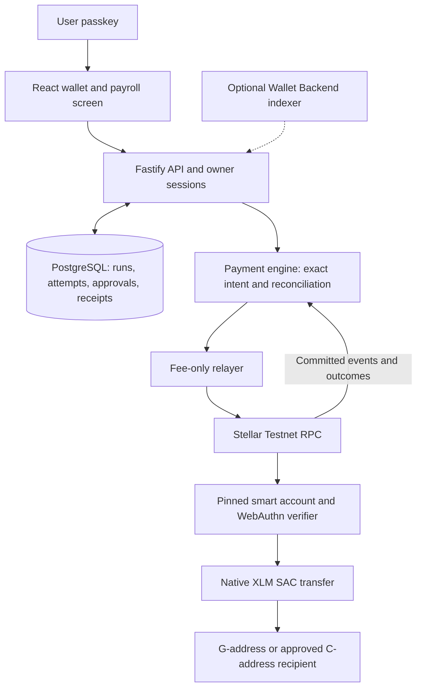

# Cherry Pay: architecture and remaining decisions

Product direction: a passkey-first Stellar wallet for cross-border payments,
with on-chain payroll disbursement orchestration. Current wallet execution is
native XLM on Stellar Testnet. Mainnet cross-chain funding is a separate gated
integration; it is not a funding route for the Testnet smart wallet.

## Libraries

| Package | Backend | Frontend | Purpose |
| --- | --- | --- | --- |
| @stellar/stellar-sdk | 16.3.0 | 14.6.1 locked | RPC, transaction/auth construction, event checks; browser address validation |
| smart-account-kit-bindings | 0.4.0 | — | Generated contract types/specification |
| @stellar/js-xdr | 4.0.0 transitive | 3.1.2 transitive | Binary encoding |
| @stellar/stellar-base | — | 14.1.0 transitive | Browser SDK primitives |
| @simplewebauthn/server | 11.0.0 | — | Server WebAuthn verification |
| @simplewebauthn/browser | — | 11.0.0 | Device registration and approval |

The full smart-account-kit npm helper is not installed. The account adapter is
pinned to OpenZeppelin stellar-contracts v0.8.0 and its structured digest. Updating
a package version alone is not authorization to change the contract or signer ABI.

## Gaps addressed in this change

- Persistent payroll runs, separate per-recipient review/approval, status recovery
  and receipts. See `PAYROLL_PILOT.md` for exact scope and limitations.
- Deployment evidence now proves that the committed transaction created the
  claimed address from its network-bound creation preimage using the expected
  WASM. An unrelated successful transaction is rejected.
- Runtime activation now checks deployment and cryptographic backup-spend
  evidence as well as current code/rules. The recovery audit also checks the
  deployment receipt. Missing/expired RPC evidence blocks activation; it does
  not silently fall back to trusting a receipt string.

## Gaps that remain open

| Gap | Required next action / mentor decision |
| --- | --- |
| Automatic per-user contract deployment and on-chain backup enrollment | Complete the existing deployment draft using reviewed upstream deployment/signer APIs; queued work and two off-chain credentials are insufficient. |
| Physical lost-primary recovery | Each owner must enroll a distinct authenticator and demonstrate a backup-only on-chain operation. Software cannot establish physical device independence. |
| Live C-to-C / payroll evidence | Run funded Testnet sender/recipient acceptance after deployment/recovery. Confirm ledger balances and receipts, then exercise restart/timeout behavior. |
| Stablecoin smart-wallet payments | Select and pin asset/issuer support, authorization and accounting rules; the current engine is native XLM only. |
| Cross-chain settlement reconciliation | Persist swaps server-side and independently verify the exact destination-chain transfer before unifying history. Keep mainnet and Testnet separate. |
| Optional Stellar Wallet Backend | Evaluate a pinned supported upstream build in a separate service/database, compare balances/history to RPC, then enable bounded owner-scoped reads. |
| Production payroll | Add organizational roles/approvals, corrections, currency policy and accounting export; tax calculations are outside this disbursement pilot. |

## Mentor conversation

“We have a passkey-authorized, fee-sponsored Stellar payment engine and a durable
payroll disbursement layer. We need to validate the smart-account deployment and
independent recovery lifecycle, then choose the stablecoin funding route. Which
upstream deployment and signer-management interfaces should we standardize on,
and what evidence should gate a mainnet pilot?”

Source reference reviewed for the contract-deployment check:
`stellar/smart-account-kit@5e86845ab57ab2644958bc3a316d6fc33fee1275`,
`src/kit/deploy-ops.ts` and
`docs/deployments-stellar-accounts-0.8-2026-10-25.md`.
