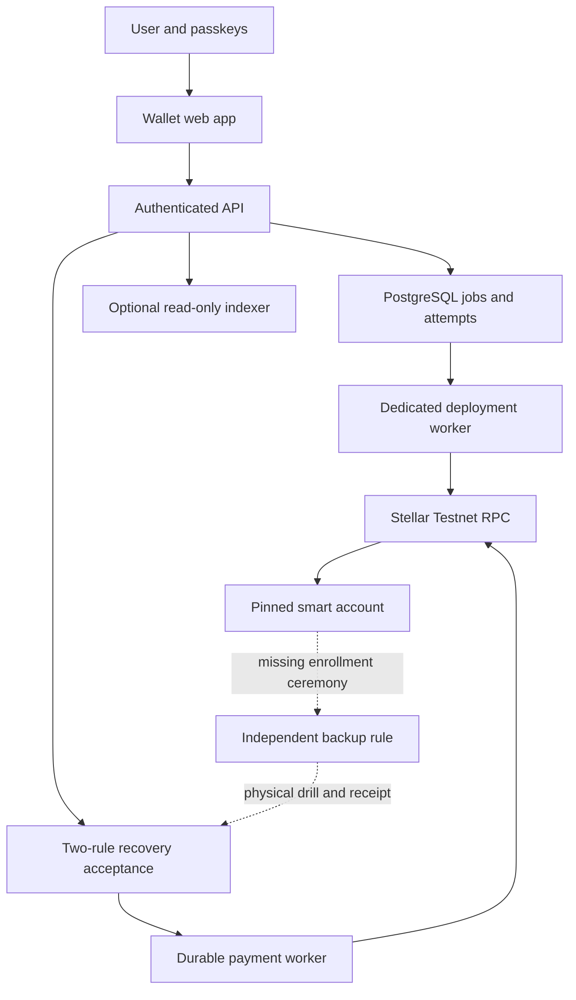

# Wallet activation status

This change integrates the automatic primary deployment worker from PR #41 with the email identity model and the payment/payroll gates in PR #43. It also wires the optional Wallet Backend client into an owner-scoped API. It does not establish live deployment or recovery evidence.

| Requested capability | Implementation and remaining acceptance |
|---|---|
| Automatic deployment / primary signer | Durable worker and browser status flow implemented. Requires a dedicated funded Testnet deployer in the running API. Queued jobs persist their exact constructor, owner credential, signed envelope and source reservation. Confirmation rechecks pinned account/verifier code and rule 0. |
| Backup signer / physical recovery | Existing receipt auditor verifies backup-only signatures. Automatic backup-rule enrollment is still missing. Registration of a second login credential does not install a contract signer. Physical independence cannot be established by signatures alone. |
| Live transfers | Existing payment runtime requires reviewed deployment/recovery evidence and current two-rule policy. No live acceptance run was performed by this change. |
| Stablecoins | Payment intent, balance store, transfer event decoder and UI are still XLM-only. USDC transfer support is not enabled. |
| Cross-chain reconciliation | Existing Aurora status is provider-reported, not independent destination settlement. The configured Testnet product has no supported Aurora funding route. Persistent cross-chain settlement reconciliation is still missing. |
| Indexer activation | Opt-in configuration, request-bound EdDSA authentication, bounded response parsing and authenticated `GET /api/v1/wallets/:walletId/indexed` are implemented. Hosting/ingestion and live parity acceptance remain operator steps. Indexed data always has `verified:false` and cannot settle payments. |

## Configure the pilot

Use `compose.activation.yaml` with the normal Compose file. Defaults disable deployment and indexer. The payment runtime still uses the separate reviewed manifest in `compose.payments.yaml`.

- `WALLET_DEPLOYMENTS_ENABLED=true`, `STELLAR_DEPLOYER_PUBLIC_KEY`, and `STELLAR_DEPLOYER_SECRET`: dedicated funded Testnet fee source. Never reuse the payment relayer source; sequence reservations are independent.
- `WALLET_DEPLOYMENT_PILOT_LIMIT`: default 100 owners; `WALLET_DEPLOYMENT_MAX_FEE_STROOPS`: default 100000000, maximum 500000000. These are ceilings, not quoted costs.
- `WALLET_INDEXER_ENABLED=true`, `WALLET_INDEXER_NETWORK=TESTNET`, `WALLET_INDEXER_URL` ending in `/graphql/query`, and `WALLET_INDEXER_SIGNING_SECRET`: separate unfunded request-authentication key. Configure its public key in Wallet Backend `CLIENT_AUTH_PUBLIC_KEYS`. Never put these values in browser configuration or commit them.
- Pin and build an audited Wallet Backend commit. `main` documentation describes unreleased behavior; the latest-release API returned 404 when checked on 2026-10-25. Do not assume a `v1.0.0` image exists because a README example mentions it.

The indexer key signs a ten-second JWT over the exact HTTP method, path and serialized body. Redirects are rejected. Responses are capped at 256 KiB, 100 balance nodes and 20 transaction nodes. The authenticated route resolves ownership before sending an address to the indexer. The deployment network setting is an operator assertion, not proof that every indexed record belongs to that network; independent RPC verification remains authoritative.

## Remaining implementation sequence

1. Implement a bounded `add_context_rule` lifecycle. The primary passkey must authorize exactly one separate permanent Default rule containing one owned, distinct backup key. Two signers in the same rule require both and do not provide independent recovery. Persist the signed envelope before submission and reconcile uncertain results before replacing it.
2. Add a backup-only recovery ceremony, with the primary device unavailable. Verify RP, origin, user verification, challenge, counter policy, committed transaction and current signer policy. Record the human-observed physical device separation independently from cryptographic evidence.
3. Run live Testnet acceptance: deploy, enroll backup, backup-only spend, restart, incoming G-to-C and C-to-C transfers, outgoing transfers, duplicate requests, submission timeout and reconciliation. Save transaction hashes and ledger evidence; provision the existing strict manifest only after these pass.
4. Add a network/code/issuer/contract asset identity to the signed intent and idempotency digest. Migrate balance/event keys per asset. Verify issued-asset SAC events and classic destination trustlines/authorization, exact seven-decimal units and issuer controls. Preserve old XLM request digests for recovery of persisted attempts. Add USDC UI only after those paths pass.
5. Persist owner-scoped cross-chain quotes and deposit addresses before showing funding instructions. Independently verify the destination chain, issuer, amount and recipient against a committed transaction. Enforce one-time destination-event allocation. Provider `SUCCESS`, an explorer link, or indexer data alone cannot mark settlement. Testnet stays disabled until a supported route is verified.
6. Deploy the pinned indexer against Testnet RPC, finish ingestion, compare sampled transactions with RPC and measure lag. Enable indexed reads only after this deployment check. Payment settlement remains based on committed RPC evidence.

## Mentor diagram

Sources: [Wallet Backend authentication](https://github.com/stellar/wallet-backend/blob/main/docs/api/authentication.md), [Wallet Backend deployment guide](https://github.com/stellar/wallet-backend/blob/main/docs/deploy/README.md). Follow documentation at the exact source commit used in the deployment.
